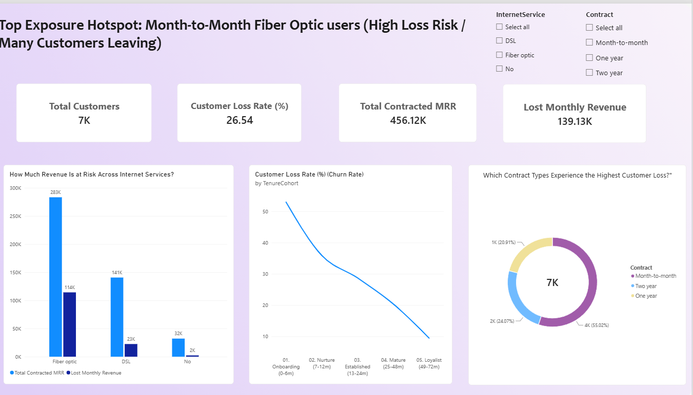
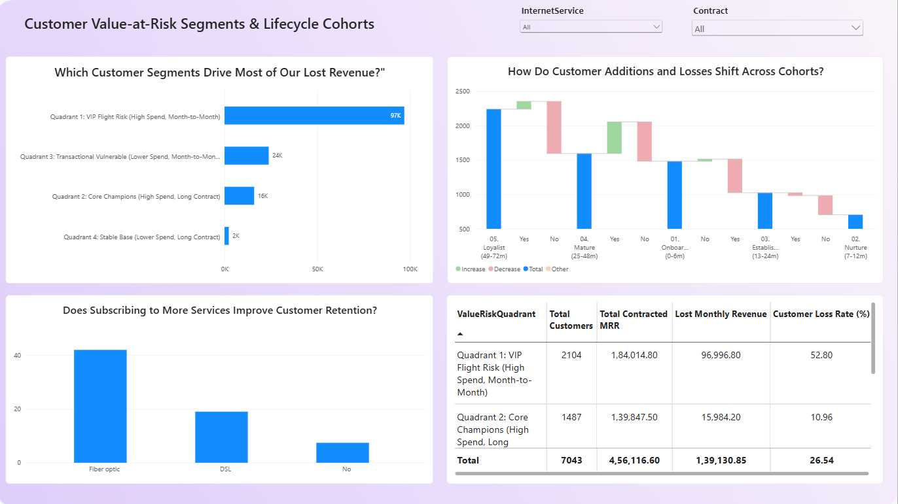
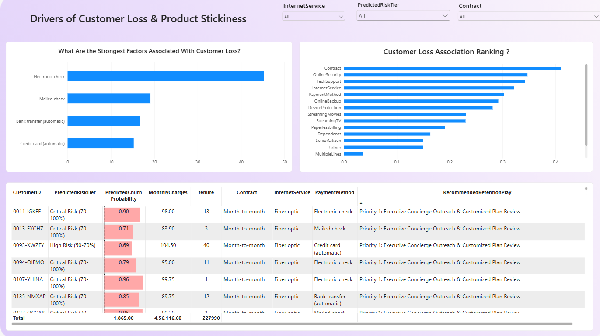

# RetainIQ – Customer Retention Analytics

[](https://www.python.org/)
[](tests/)
[](https://pep8.org/)
[](LICENSE)

An enterprise customer analytics, statistical inference, and machine learning retention platform built on the IBM Telco Customer Churn dataset. Developed from the perspective of a **Senior Customer Analytics Data Scientist & Lead BI Developer**, RetainIQ translates raw account and contract records into financial reconciliations, behavioral customer segmentation, predictive retention queues, and executive Power BI architecture.

---

## 1. Executive Summary & Problem Alignment

| Requirement / Component | RetainIQ Implementation | Source Files & Artifacts | Empirical Key Output |
| :--- | :--- | :--- | :--- |
| **Ingestion & Validation** | Strict schema validation, customer uniqueness assertions, imputation of 11 whitespace `TotalCharges` for `tenure=0`. | [`src/ingestion.py`](src/ingestion.py) | 7,043 rows, 21 raw columns, 0 nulls post-cleaning. |
| **Reproducible EDA** | Chi-Square tests with Cramér's V, Mann-Whitney U, Welch's t-test, 5 high-res figures. | [`src/eda.py`](src/eda.py)<br>[`reports/eda_report.md`](reports/eda_report.md) | Contract (Cramér's V = 0.4098) & OnlineSecurity (0.3470) are top correlates. Median tenure of customers who left is 10 mo vs 38 mo for customers who stayed. |
| **Business Metrics Engine** | Mathematical reconciliation of volume, tenure, MRR, and lost recurring charges. | [`src/metrics.py`](src/metrics.py)<br>[`docs/business_metrics_definitions.md`](docs/business_metrics_definitions.md) | Total MRR: $456,116.60 ($316,985.75 from customers who stayed + $139,130.85 lost monthly revenue). Qualified against "future loss". |
| **SQL Analytical Mart** | SQLite database schema with indexes and 16 readable, production-grade queries. | [`sql/schema.sql`](sql/schema.sql)<br>[`sql/queries.sql`](sql/queries.sql)<br>[`src/db.py`](src/db.py) | 16/16 queries verified with non-empty results; matches Python metric calculations to the cent. |
| **Customer Segmentation** | 4-Quadrant Value-at-Risk matrix, 5-stage lifecycle tenure cohorts, service breadth index. | [`src/segmentation.py`](src/segmentation.py)<br>[`docs/segmentation_and_non_causal_interpretation.md`](docs/segmentation_and_non_causal_interpretation.md) | Q1 VIP Flight Risk (2,104 customers, 52.8% customer loss rate) drives **69.72% ($96,996.80)** of total lost monthly revenue. |
| **Leakage-Free ML** | Stratified 80/20 split; train-only fitted `ColumnTransformer`; Logistic Regression vs. HistGradientBoosting; threshold trade-off curve. | [`src/modeling.py`](src/modeling.py)<br>[`reports/model_evaluation_report.md`](reports/model_evaluation_report.md) | Logistic Reg: **0.8422 ROC-AUC / 0.6349 PR-AUC**.<br>Optimal threshold ($\tau=0.25$) achieves **79.14% Recall**. |
| **Power BI Architecture** | Star-schema ER model, 12 production DAX measures, 4 page wireframes, 5 export tables. | [`docs/power_bi_dashboard_spec.md`](docs/power_bi_dashboard_spec.md)<br>[`src/export_power_bi.py`](src/export_power_bi.py)<br>[`exports/`](exports/) | 5 star-schema CSV tables ready for Power BI import, including prioritized customer queue. |
| **Causal Limitations** | Non-causal interpretation guardrails, selection bias analysis, enterprise A/B trial protocol. | [`docs/limitations_and_experimentation.md`](docs/limitations_and_experimentation.md) | Correlation $\neq$ causation; sample size formulas and uplift modeling segmentation. |

---

## 2. Repository Layout

```
telephone_service/
├── .gitignore
├── requirements.txt
├── README.md
├── WA_Fn-UseC_-Telco-Customer-Churn.csv   # Raw source dataset
├── data/
│   ├── raw/                              # Source copy
│   └── processed/
│       ├── telco_churn_clean.csv         # Cleaned, typed dataset
│       ├── telco_analytics_mart.csv      # Enriched with cohorts & quadrants
│       ├── telco_churn_scored.csv        # Holdout model predictions & risk tiers
│       └── telco.db                      # Embedded SQLite analytical database
├── docs/
│   ├── data_dictionary.md                # 21 raw + 6 derived features
│   ├── business_metrics_definitions.md   # Mathematical KPI catalog & accounting caveats
│   ├── power_bi_dashboard_spec.md        # Star-schema, DAX measures, layout wireframes
│   ├── segmentation_and_non_causal_interpretation.md
│   └── limitations_and_experimentation.md # A/B testing protocol & causal guardrails
├── sql/
│   ├── schema.sql                        # SQLite / ANSI DDL with indexes
│   └── queries.sql                       # 16 production-grade analytical queries
├── src/
│   ├── __init__.py
│   ├── ingestion.py                      # Data validation & cleaning engine
│   ├── eda.py                            # Hypothesis testing & chart generation
│   ├── metrics.py                        # KPI calculation & balance sheet reconciliation
│   ├── db.py                             # SQLite mart loader & query runner
│   ├── segmentation.py                   # Value-at-Risk & lifecycle cohorting
│   ├── modeling.py                       # ML pipeline & decision threshold optimizer
│   └── export_power_bi.py                # Star-schema tables & operational queue exporter
├── exports/                              # Direct Power BI import CSVs
│   ├── fact_customer_retention.csv
│   ├── power_bi_executive_overview.csv
│   ├── power_bi_churn_drivers.csv
│   ├── power_bi_segments_cohorts.csv
│   └── power_bi_retention_prioritization.csv
├── reports/
│   ├── eda_report.md                     # Statistical inference findings
│   ├── model_evaluation_report.md        # Model benchmarks & threshold sensitivity
│   └── figures/                          # 12 high-resolution charts
└── tests/
    ├── __init__.py
    ├── test_ingestion.py                 # 7 tests (schema, uniqueness, typing, blanks)
    ├── test_metrics.py                   # 3 tests (financial reconciliation, SQL queries)
    ├── test_segmentation.py              # 6 tests (quadrants, cohorts, mart integrity)
    ├── test_modeling.py                  # 6 tests (split, leakage, ROC/PR curves, thresholds)
    └── test_exports.py                   # 1 test (export schemas, row counts, action rules)
```

---

## 3. Step-by-Step Reproducible Run Commands

All commands can be executed from the project root using standard Python:

```bash
# 1. Install dependencies
pip install -r requirements.txt

# 2. Execute Data Ingestion & Integrity Validation
python -m src.ingestion

# 3. Generate Reproducible EDA & Statistical Reports
python -m src.eda

# 4. Initialize SQLite Database & Execute 16 Analytical Queries
python -m src.db

# 5. Execute Customer Segmentation & Value-at-Risk Engine
python -m src.segmentation

# 6. Train Leakage-Free ML Models & Export Predictions
python -m src.modeling

# 7. Generate Power BI Star-Schema Export Tables & Action Queue
python -m src.export_power_bi

# 8. Run Full Automated Test Suite (23 Tests)
python -m pytest tests/ -v
```

---

## 4. Reconciled Financial & Business Scorecard

```
================================================================================
                    RETAINIQ RECONCILED BUSINESS SCORECARD
================================================================================
Total Customer Base                :  7,043 accounts (100.0%)
Customers Who Stayed (Active)      :  5,174 accounts (73.46%)
Customers Lost (Who Left)          :  1,869 accounts (26.54%)
--------------------------------------------------------------------------------
Average Overall Tenure             :  32.37 months (Median: 29.0 mo)
Average Tenure (Customers Stayed)  :  37.57 months (Median: 38.0 mo)
Average Tenure (Customers Left)    :  17.98 months (Median: 10.0 mo)
--------------------------------------------------------------------------------
Total Monthly Contracted Charges   :  $456,116.60 / month (100.0%)
Revenue from Customers Who Stayed  :  $316,985.75 / month (69.50%)
Lost Monthly Revenue (Historical)* :  $139,130.85 / month (30.50%)
Average Monthly Spend (Stayed)     :  $61.27 / month
Average Monthly Spend (Left)       :  $74.44 / month
================================================================================
*Qualified: Contracted monthly recurring volume of defecting accounts at time of loss.
Not future lost revenue due to month-to-month contracts and gross acquisition offsets.
```

---

## 5. Machine Learning Evaluation & Decision Thresholds

### Test-Set Performance Comparison (80/20 Stratified Split, 1,409 Test Accounts)
- **Baseline Logistic Regression**: ROC-AUC = **0.8422**, PR-AUC = **0.6349**, Brier Score = **0.1380**.
- **Stronger HistGradientBoosting**: ROC-AUC = **0.8310**, PR-AUC = **0.6344**, Brier Score = **0.1425**.

### Decision Threshold ($\tau$) Optimization (HistGradientBoosting)
In telecommunications retention, the default 0.50 threshold suffers from severe false negatives. RetainIQ provides operational threshold tiers:

| Threshold ($\tau$) | Precision | Recall | F1-Score | Operational Use Case |
| :--- | :--- | :--- | :--- | :--- |
| **$\tau = 0.25$** | **51.7%** | **79.1%** | **0.6251** | **Optimal F1 & High-Volume Digital Nurture**: Catches 296 of 374 defectors. |
| **$\tau = 0.35$** | **54.7%** | **68.2%** | **0.6071** | **Targeted Outbound Outreach**: Balances contact volume with coverage. |
| **$\tau = 0.50$** | **61.7%** | **51.6%** | **0.5619** | **Default Scikit-Learn Cutoff**: Misses nearly half of defecting accounts. |
| **$\tau = 0.65$** | **71.8%** | **34.8%** | **0.4685** | **High-Touch Concierge / Hardware Replacement**: Limits expensive false alarms. |

---

## 6. Power BI Dashboard & Visualizations

To import RetainIQ into Power BI Desktop:
1. Open Power BI Desktop -> **Get Data** -> **Text/CSV**.
2. Select [`exports/fact_customer_retention.csv`](exports/fact_customer_retention.csv) as your primary fact table.
3. Import the dimension/summary tables:
   - [`exports/power_bi_executive_overview.csv`](exports/power_bi_executive_overview.csv)
   - [`exports/power_bi_churn_drivers.csv`](exports/power_bi_churn_drivers.csv)
   - [`exports/power_bi_segments_cohorts.csv`](exports/power_bi_segments_cohorts.csv)
   - [`exports/power_bi_retention_prioritization.csv`](exports/power_bi_retention_prioritization.csv)
4. Create the `_Measures` table and paste the 12 DAX formulas specified in [`docs/power_bi_dashboard_spec.md`](docs/power_bi_dashboard_spec.md).

### Dashboard Views

#### View 1: Executive Overview & Financial Exposure

*Displays core KPIs (7,043 customer base, 26.54% loss rate, $456.12K MRR, $139.13K lost monthly revenue), monthly revenue at risk across Internet service types, tenure cohort hazard decay curve, and contract distribution.*

#### View 2: Customer Value-at-Risk Segments & Lifecycle Cohorts

*Highlights Quadrant 1 (VIP Flight Risk) driving $97.0K in lost revenue, customer additions/losses waterfall analysis across lifecycle cohorts, and service breadth impact on retention.*

#### View 3: Drivers of Customer Loss & Operational Retention Queue

*Identifies top defect factors (electronic check, contract type), feature association rankings (Cramér's V), and the operational customer queue with predicted churn probabilities and recommended retention plays.*
