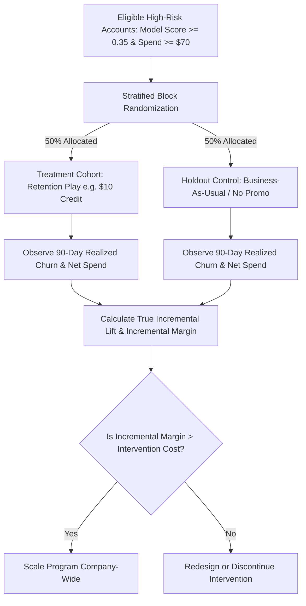

# RetainIQ – Analytical Limitations & Enterprise Experimentation Playbook

## 1. Analytical & Dataset Limitations

### A. Observational Cross-Sectional Bias (Survival Bias)
- **Static Window**: The IBM Telco dataset is an observational cross-sectional snapshot representing active customers alongside customers who defected within an observed period. 
- **Omission of Rapid Churners**: Customers who enrolled and defected within the same billing month prior to data capture are underrepresented or omitted, creating right-censoring and survivor bias in long-tenure cohorts.

### B. Omitted Variable Bias (Unobserved Confounders)
Crucial drivers of real-world telecommunication churn are absent from this dataset:
1. **Network Quality of Service (QoS)**: Actual latency, packet loss, fiber dropouts, and download speeds.
2. **Customer Care Interactions**: Volume of technical complaint tickets, dispute escalations, and Average Handle Time (AHT).
3. **Competitive Landscape**: Overlapping regional coverage of competitors offering promo gigabit pricing in the customer's specific geography.
4. **Macroeconomic Shocks**: Local cost-of-living increases, inflation, and credit score migrations.

### C. Financial Metric Qualification
- **Contracted Monthly Recurring Charges of Churned Customers ($139,130.85)** represents the run-rate billed volume of customers at the moment of churn.
- **Qualification**: Calling this figure "Annualized Future Lost Revenue ($1.67M)" without qualification is mathematically invalid because:
  1. 88.5% of defecting customers were month-to-month with no legal obligation to pay past 30 days.
  2. New customer acquisitions continuously backfill churned capacity.
  3. Promotional discounts on churned lines would have expired, altering subsequent billing rates.

---

## 2. Epistemological Guardrails

> [!CAUTION]
> **1. Correlation $\neq$ Causation**: High empirical association (e.g., Electronic Check users having a 45.3% churn rate) does not imply that forcing users onto Credit Card autopay will eliminate defection. Customers choosing electronic check may share unobserved credit fragility or lower product commitment.  
> **2. Churn Probability $\neq$ Certainty**: A predicted score of 0.82 represents an expected empirical rate among similar feature profiles; it is not a deterministic guarantee that an account will defect.

---

## 3. How the Business Must Validate Retention Actions: The A/B Testing Framework

To ensure marketing and retention budgets are allocated profitably, all retention interventions must be evaluated through **Randomized Controlled Trials (RCTs)** rather than observational before-and-after studies.

### Step 1: Cohort Eligibility & Sample Size Determination
- **Target Population**: Active accounts classified as `Quadrant 1: VIP Flight Risk` with `PredictedChurnProbability >= 0.35`.
- **Power Calculation**: For a baseline churn rate of $P_0 = 0.50$, to detect a Minimum Detectable Effect (MDE) of $\Delta = 5\%$ absolute reduction ($\alpha = 0.05$, power $1-\beta = 0.80$):
  $$n \approx \frac{2 \times (1.96 + 0.84)^2 \times (0.50 \times 0.50)}{(0.05)^2} \approx 1,568 \text{ accounts per arm}$$

### Step 2: Stratified Block Randomization
To avoid confounding, randomly assign accounts 1:1 into Treatment and Control, blocking across:
1. `TenureCohort` (e.g. 0-6m vs. 25-48m)
2. `InternetService` (Fiber Optic vs. DSL)
3. `MonthlyCharges` quintiles

### Step 3: Measuring Uplift & Net ROI
Never judge a campaign by the gross retention of the treatment group. Instead, evaluate the **Incremental Treatment Effect (ITE)**:

$$\text{Incremental Retention Lift} = CR_{\text{Control}} - CR_{\text{Treatment}}$$

$$\text{Net Incremental Value} = (N_{\text{Treatment}} \times \text{Lift} \times \text{CLV}) - (N_{\text{Treatment}} \times \text{Cost per Intervention})$$

### Step 4: Uplift Modeling Segmentation
Before rolling out broad retention discounts, categorize customers into four causal quadrants:
1. **Persuadables**: Customers who will stay *only if* treated. **(Target with 100% of budget)**.
2. **Sure Things**: Customers who will stay regardless of intervention. **(Do not discount)**.
3. **Lost Causes**: Customers who will defect regardless of intervention. **(Do not waste budget)**.
4. **Sleeping Dogs (Do Not Disturb)**: Customers who are triggered to review their bills and cancel when contacted. **(Strictly exclude from outreach)**.
