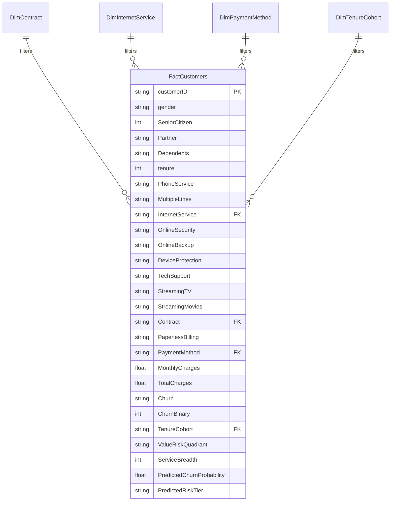

# RetainIQ – Power BI Executive Retention Dashboard Specification

This specification provides the data model architecture, DAX measure dictionary, slicer definitions, and wireframe layouts for the **RetainIQ Power BI Dashboard**.

---

## 1. Data Model Architecture (Star Schema)



---

## 2. Production DAX Measure Catalog

Create a dedicated calculation table in Power BI named `_Measures`:

### Volume & Loss (Churn) Core Measures
```dax
Total Customers = 
COUNTROWS('FactCustomers')
```

```dax
Customers Lost (Churn) = 
CALCULATE(
    COUNTROWS('FactCustomers'),
    'FactCustomers'[Churn] = "Yes"
)
```

```dax
Customers Who Stayed (Active Customers) = 
CALCULATE(
    COUNTROWS('FactCustomers'),
    'FactCustomers'[Churn] = "No"
)
```

```dax
Customer Loss Rate (%) (Churn Rate) = 
DIVIDE([Customers Lost (Churn)], [Total Customers], 0) * 100
```

### Financial & Contracted Charges Measures
```dax
Total Contracted MRR = 
SUM('FactCustomers'[MonthlyCharges])
```

```dax
Revenue from Customers Who Stayed = 
CALCULATE(
    SUM('FactCustomers'[MonthlyCharges]),
    'FactCustomers'[Churn] = "No"
)
```

```dax
Lost Monthly Revenue (Historical) (Churned MRC) = 
CALCULATE(
    SUM('FactCustomers'[MonthlyCharges]),
    'FactCustomers'[Churn] = "Yes"
)
```

```dax
Lost Monthly Revenue Share (%) = 
DIVIDE([Lost Monthly Revenue (Historical) (Churned MRC)], [Total Contracted MRR], 0) * 100
```

### Tenure & Predictive Action Measures
```dax
Avg Customer Tenure (Months) = 
AVERAGE('FactCustomers'[tenure])
```

```dax
Avg Tenure of Customers Who Left (Months) = 
CALCULATE(
    AVERAGE('FactCustomers'[tenure]),
    'FactCustomers'[Churn] = "Yes"
)
```

```dax
Avg Loss Risk Probability = 
AVERAGE('FactCustomers'[PredictedChurnProbability])
```

```dax
High Value At Risk Customers Count = 
CALCULATE(
    COUNTROWS('FactCustomers'),
    'FactCustomers'[MonthlyCharges] >= 70.0,
    'FactCustomers'[PredictedChurnProbability] >= 0.50,
    'FactCustomers'[Churn] = "No"
)
```

```dax
High Value At Risk MRR Exposure = 
CALCULATE(
    SUM('FactCustomers'[MonthlyCharges]),
    'FactCustomers'[MonthlyCharges] >= 70.0,
    'FactCustomers'[PredictedChurnProbability] >= 0.50,
    'FactCustomers'[Churn] = "No"
)
```

---

## 3. Dashboard Page Architecture & Visual Layout

### Page 1: Executive Overview & Financial Exposure
- **Top KPI Cards**: Total Customers (7,043) | Customer Loss Rate (%) (Churn) (26.5%) | Total Contracted MRR ($456.1K) | Lost Monthly Revenue (Historical) ($139.1K).
- **Visual 1 (Donut Chart)**: Customer Base Volume & Customer Loss Rate (%) by `Contract`.
- **Visual 2 (Clustered Column Chart)**: Total MRR vs. Lost Monthly Revenue (Historical) by `InternetService`.
- **Visual 3 (Line / Area Chart)**: Empirical Customer Loss Rate (%) across `TenureCohort` (Hazard Decay Curve).
- **Visual 4 (Card Callout)**: Top Exposure Hotspot: Month-to-Month Fiber Optic users (High Loss Risk / Many Customers Leaving).

### Page 2: Drivers of Customer Loss & Product Stickiness
- **Visual 1 (Matrix / Heatmap)**: `TechSupport` vs. `OnlineSecurity` showing Customer Loss Rate (%) and Customer Volume.
- **Visual 2 (Horizontal Bar Chart)**: Feature Correlation ranking (Cramér's V from `power_bi_churn_drivers.csv`).
- **Visual 3 (Clustered Bar Chart)**: Customer Loss Rate (%) by `PaymentMethod` (Highlighting Electronic Check @ 45.3%).
- **Visual 4 (Scatter Plot)**: `MonthlyCharges` vs. `tenure` colored by Customer Status (`Customers Who Left` vs `Customers Who Stayed`).

### Page 3: Customer Value-at-Risk Segments & Lifecycle Cohorts
- **Visual 1 (100% Stacked Bar)**: Lost Monthly Revenue Share (%) by `ValueRiskQuadrant` (Demonstrating Q1 drives 69.7% of exposure).
- **Visual 2 (Waterfall Chart)**: Customer additions/subtractions across Tenure Cohorts (Customers Who Stayed vs Customers Who Left).
- **Visual 3 (Bar Chart)**: Customer Loss Rate (%) by `ServiceBreadth` (0 to 6 active ancillary services).
- **Visual 4 (Summary Table)**: Quadrant Scorecard (Base %, MRR %, Customer Loss Rate %, Strategy; High Loss Risk vs Low Loss Risk / Stable Accounts).

### Page 4: Predictive Retention Prioritization (Action Queue)
- **Top Slicers**:
  - `Risk Tier Filter` (`Critical Risk (70-100%)`, `High Loss Risk (50-70%)`, `Moderate`, `Low Loss Risk / Stable Accounts`)
  - `Loss Risk Probability Threshold Slider` (`>= 0.30`)
  - `Contract Commitment` (`Month-to-month` priority)
- **Primary Operational Table Visual**:
  - Display Table Headers: `Customer ID`, `Risk Tier`, `Loss Risk Probability (Churn Probability)`, `Monthly Charges`, `Tenure (Months)`, `Contract`, `Internet Service`, `Payment Method`, `Recommended Retention Play`.
  - Underlying Fields: `customerID`, `PredictedRiskTier`, `PredictedChurnProbability`, `MonthlyCharges`, `tenure`, `Contract`, `InternetService`, `PaymentMethod`, `RecommendedRetentionPlay`.
  - Conditional Formatting: Red data bar on `PredictedChurnProbability` (Loss Risk Probability), soft amber on `MonthlyCharges >= $70`.
  - Sort: `PredictedChurnProbability` DESC, `MonthlyCharges` DESC.

---

## 4. Standard Slicer Configuration

| Slicer Name | Field Source | Control Type | Default Selection |
| :--- | :--- | :--- | :--- |
| **Contract** | `'FactCustomers'[Contract]` | Tile / Buttons | All (Multi-select) |
| **Internet Service** | `'FactCustomers'[InternetService]` | Dropdown | All |
| **Payment Method** | `'FactCustomers'[PaymentMethod]` | Dropdown | All |
| **Lifecycle Cohort** | `'FactCustomers'[TenureCohort]` | Vertical List | All |
| **Model Risk Tier** | `'FactCustomers'[PredictedRiskTier]` | Buttons | High Loss Risk + Critical Risk |
| **Senior Citizen** | `'FactCustomers'[SeniorCitizen]` | Toggle (0/1) | All |
