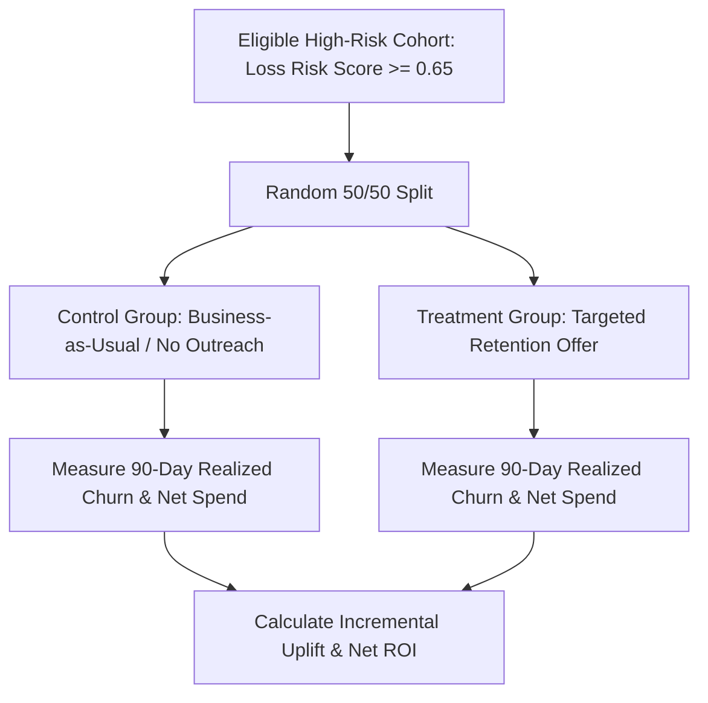

# RetainIQ – Customer Segmentation & Non-Causal Interpretation Guide

## 1. Executive Summary: Value-at-Risk Customer Quadrants

To move beyond generic loss rates, RetainIQ stratifies the 7,043 customer accounts into four mutually exclusive operational quadrants balancing financial exposure ($\text{MonthlyCharges} \ge \$70/\text{mo}$) and contractual defection hazard ($\text{Contract} = \text{'Month-to-month'}$).

| Quadrant | Base Volume (%) | Total Monthly Charges (%) | Customer Loss Rate (%) | Lost Monthly Revenue (Historical) | Strategic Operational Action |
| :--- | :--- | :--- | :--- | :--- | :--- |
| **Q1: VIP Flight Risk** *(High Loss Risk / Many Customers Leaving; Spend $\ge \$70$, Month-to-Month)* | **2,104** (29.9%) | **$184,014.80** (40.3%) | **52.80%** | **$96,996.80** (69.7% of total lost revenue) | Proactive executive concierge outreach, fiber quality checks, customized rate plans. |
| **Q2: Core Champions** *(Low Loss Risk / Stable Accounts; Spend $\ge \$70$, 1–2 Yr Contract)* | **1,487** (21.1%) | **$139,847.50** (30.7%) | **10.96%** | **$15,984.20** (11.5% of total lost revenue) | Loyalty rewards, VIP perks, priority support, referral advocacy incentives. |
| **Q3: Transactional Vulnerable** *(High Loss Risk / Many Customers Leaving; Spend $< \$70$, Month-to-Month)* | **1,771** (25.1%) | **$73,279.35** (16.1%) | **30.72%** | **$23,850.30** (17.1% of total lost revenue) | Digital self-service onboarding, automated billing setup, onboarding nurture emails. |
| **Q4: Stable Base** *(Low Loss Risk / Stable Accounts; Spend $< \$70$, 1–2 Yr Contract)* | **1,681** (23.9%) | **$58,974.95** (12.9%) | **3.03%** | **$2,299.55** (1.7% of total lost revenue) | Automated maintenance, low-touch servicing, cross-sell to higher-tier broadband. |

---

## 2. Customer Lifecycle Tenure Cohorts

Analysis of customer loss rate across customer longevity demonstrates an unmistakable hazard curve peaking in early tenure:

1. **01. Onboarding (0–6 months)**: 1,481 customers | **49.83% customer loss rate** | Critical vulnerability window.
2. **02. Nurture (7–12 months)**: 694 customers | **39.05% customer loss rate** | Post-onboarding stabilization.
3. **03. Established (13–24 months)**: 1,024 customers | **28.71% customer loss rate** | Approaching base equilibrium.
4. **04. Mature (25–48 months)**: 1,594 customers | **20.70% customer loss rate** | Habitual brand usage.
5. **05. Loyalist (49–72 months)**: 2,250 customers | **10.58% customer loss rate** | Enduring brand affinity.

---

## 3. Mandatory Non-Causal Interpretation Guardrails

> [!CAUTION]
> **Core Principle: Correlation is NOT Causation; Loss Risk Propensity is NOT Certainty.**

As customer analytics data scientists, we must enforce strict epistemic guardrails against common commercial misinterpretations:

### A. The Contract Type Endogeneity / Self-Selection Fallacy
- **The Observation**: Customers on Two-Year contracts experience a 2.8% customer loss rate, while Month-to-Month customers lose 42.7%.
- **The Common Mistake**: Believing that forcing or incentivizing Month-to-Month customers into 2-year contracts will automatically reduce their loss rate to 2.8%.
- **The Reality**: Customers who choose long-term contracts *already have a fundamentally lower underlying propensity to defect* (unobserved loyalty, business stability, or home ownership). A customer looking to move cities in 3 months will refuse or default on a 2-year contract. Contract length is an **indicator**, not the exclusive **cause**.

### B. The Tech Support & Cybersecurity Attachment Bias
- **The Observation**: Customers with `TechSupport = 'Yes'` experience a 15.2% loss rate, whereas those without experience 41.6%.
- **The Common Mistake**: Mandating free tech support attachments across all accounts expecting defection to plummet.
- **The Reality**: Customers who actively configure and request tech support are more engaged users who have integrated the service into their daily workflows. The attachment is a symptom of high product engagement.

### C. Loss Risk Probability vs. Deterministic Defection
- A predicted loss risk score (churn probability) of `0.78` does **not** mean the customer is guaranteed to leave tomorrow. It means that within a population sharing identical observable features, approximately 78 out of 100 defected under historical baseline conditions. Treating probabilistic predictions as deterministic outcomes leads to expensive and wasteful commercial over-discounting.

---

## 4. How the Business Must Validate Retention Actions: The A/B Testing Framework

Before scaling any algorithmic retention intervention company-wide, the enterprise must execute a **Randomized Controlled Trial (RCT)**:

1. **Cohort Selection**: Filter to target segment (e.g., Q1 VIP Flight Risk with predicted loss risk probability $\ge 0.60$).
2. **Random Assignment**: Randomly divide into Treatment (receives retention offer, e.g., $15/mo discount or free speed upgrade) and Holdout Control (receives standard business-as-usual communications).
3. **Statistical Power**: Ensure sample size exceeds minimum detectable effect (MDE) requirements.
4. **Primary Metric**: **Incremental Retention Uplift** ($CR_{\text{control}} - CR_{\text{treatment}}$) and **Net Revenue Impact** accounting for offer subsidy costs.
